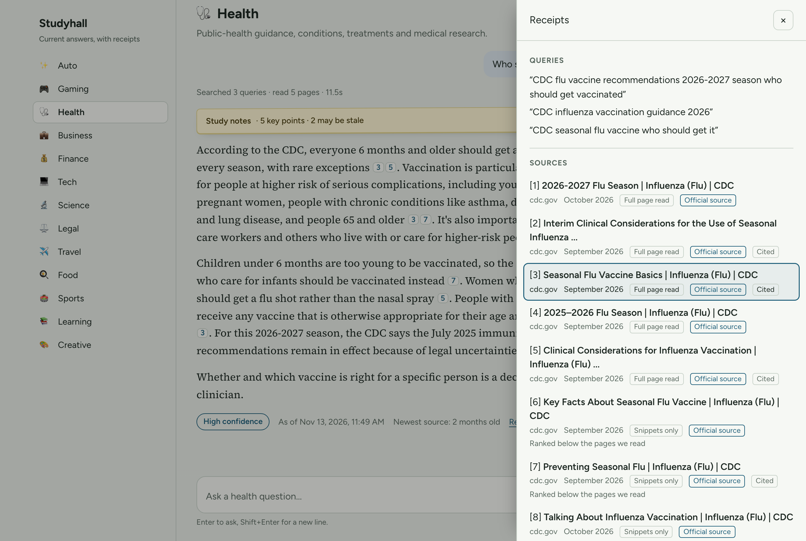

# Studyhall

A category-organized chatbot that studies before it answers: it searches the live web (You.com), reads the sources, answers only from what it read with inline citations, checks its own claims, and shows the receipts.

It has two surfaces on one engine: a web chatbot and a Claude Code plugin (MCP server, slash commands, skill, fact-checking subagent).

See [PLAN.md](PLAN.md) for the full build plan and [DECISIONS.md](DECISIONS.md) for deviations.

## Status

| Phase | Status |
|---|---|
| 0 Scaffold | ✅ done |
| 1 Providers | ✅ done |
| 2 Categories + pipeline | ✅ done |
| 3 API route (SSE) | ✅ done |
| 4 Website UI | ✅ done |
| 5 Compare mode + About | not started |
| 6 Evals | not started |
| 7 Deploy + demo | not started |
| 8 Bonus: MCP server + plugin | not started |

## Setup

Requires Node 20+ and pnpm 10.

```bash
pnpm install
cp .env.example .env   # fill in YDC_API_KEY
ant auth login         # or put ANTHROPIC_API_KEY in .env
pnpm build
pnpm test
pnpm lint
pnpm smoke             # one live call to each provider
```

## Ask a question

```bash
pnpm ask health "Who should get a flu shot this season?"
pnpm ask auto "What is the latest stable version of Python?"   # auto picks the category
pnpm ask finance "What is the current federal funds rate?" --json   # full receipts
```

Categories: gaming, health, business, finance, tech, engineering, science, legal, travel, food, sports, learning, creative (or `auto`). Engineering Software is version-aware: answers open with the release their sources describe, and code is checked function by function against the sources.

`pnpm --filter core manual [--name run-name]` runs all 36 starter questions live and writes `evals/manual/<run-name>.md`.
`pnpm --filter core planted [--record]` plants number, negation and entity errors in real answers and checks that verify flags each one unsupported.
`STUDYHALL_LIVE=1 pnpm --filter core test` also re-runs the recorded planted-error checks against the live model.

## Website

```bash
pnpm build && pnpm --filter @studyhall/web start   # http://localhost:3000
```

Pick a category in the rail (or `/#health`), ask, and watch it study: status line, study notes, the streamed answer with citation chips, verdict underlines, and the confidence footer. **Receipts** opens the full trace.

| Mid-answer | Finished | Receipts |
|---|---|---|
|  |  |  |

All 12 screenshots (375px and 1280px, light and dark) are in [docs/screenshots](docs/screenshots). Regenerate them with `node scripts/screenshots.mjs` against a running app (uses 4 live questions). `node scripts/keyboard-check.mjs` runs the keyboard-only checks.

Set `DAILY_QUESTION_CAP` (default 500) to cap answered questions per day on a public deploy.

## API

Run the web app (`pnpm --filter @studyhall/web dev`, or `build` then `start`), then:

```bash
curl -N -X POST localhost:3000/api/answer -H 'content-type: application/json' \
  -d '{"question":"What is the current federal funds rate target range?","category":"finance","history":[]}'
```

The response is Server-Sent Events: one `event: <type>` / `data: <json>` message per pipeline event (`category`, `planning`, `queries`, `searching`, `sources`, `reading`, `notes`, `answer_delta`, `answer_replaced`, `verifying`, `verdicts`, `done`, `error`). The `done` event carries the full receipts. Limits: questions up to 1,000 characters, history up to 6 turns, 10 questions per minute per IP. Closing the connection cancels every upstream call.

`GET /api/categories` lists the categories (public fields only). `GET /api/health` reports liveness and which keys are set.

## Layout

```
packages/core        engine: categories, pipeline, providers (no UI)
packages/mcp-server  stdio MCP server exposing core as tools
apps/web             Next.js chat app (Phase 6)
plugin/              Claude Code plugin (Phase 4)
evals/               questions, runner, results (Phase 5)
```
