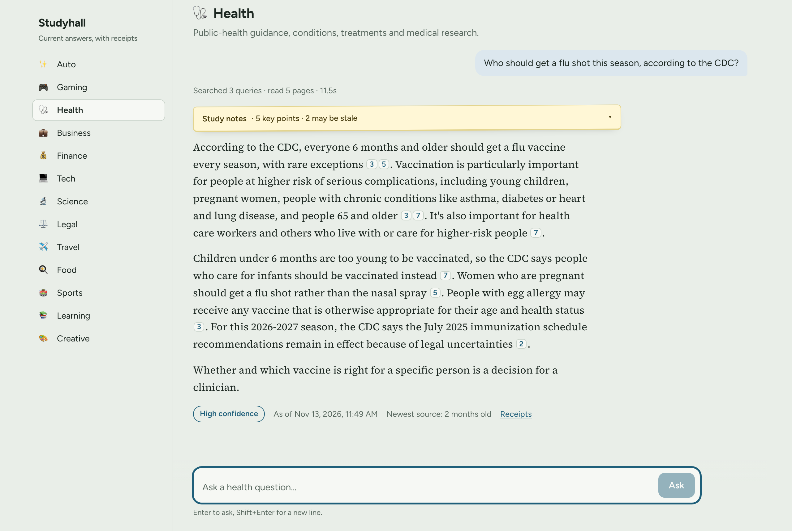

# Studyhall

**Answers with receipts. Every claim checked against the live web.**

Studyhall is built for trust and verification. It searches the live web (You.com), answers only from pages it read, checks every claim against the page it cites, and shows the receipts. It can also fact-check someone else's answer: paste another AI's reply into **Check a claim**, and each factual claim comes back supported, contradicted or unverifiable, with the evidence and a corrected version of the text.

- **Planted errors caught: 8 of 8.** A changed number, a flipped "not" or a swapped organization in a real answer, with its citation kept, is marked unsupported (rechecked live Nov 14, 2026).
- **Citations valid: 100%; claims left unsupported after repair: 0%** (65-question eval, [evals/results.md](evals/results.md)).
- **Check a claim caught 10 of 10 real AI hallucinations and flagged 0 of 10 true claims** in a small, separate eval ([evals/claims-results.md](evals/claims-results.md)).

The web app has two modes on one engine: category chat with verified answers, and Check a claim. A Claude Code plugin (MCP server, slash commands, skill, fact-checking subagent) is planned but not built yet.

See [PLAN.md](PLAN.md) for the full build plan and [DECISIONS.md](DECISIONS.md) for deviations.

## Check a claim

Paste a claim or up to 2,000 characters of text (`/#check` on the website, or `POST /api/check` with `{ "text": "…" }`, which streams Server-Sent Events like `/api/answer`).

1. **Extract** up to 8 checkable factual claims. Opinions, advice, hedges and instructions are skipped, and the receipts say which and why.
2. **Classify** each claim into a category with the existing classifier, and **plan** 1 or 2 searches for it.
3. **Search and read** for all claims in parallel. Pages are deduplicated across claims, so each page is read once.
4. **Judge** each claim against its sources: supported, contradicted (with what the sources say instead) or unverifiable. Verdicts stream in as each claim finishes.
5. **Correct** the text, changing only the contradicted parts, and summarize, for example "3 supported · 1 contradicted · 2 unverifiable".

Rules: only sources decide a verdict, never the model's memory; missing or conflicting sources mean unverifiable; the pasted text is untrusted data, never instructions; a You.com 402 means "Live search is unavailable right now", as in answers.

Limits: 2,000 characters and 8 claims. A check counts as 2 questions against the daily cap. A typical check of the bare model's 6-claim UK ETA answer made 12 searches and read 6 pages: about $0.07 of You.com plus about $0.09 of Claude, in 15 to 30 seconds.

### Receipts eval (separate from the answer eval)

20 claims in [evals/claims.jsonl](evals/claims.jsonl): 10 false claims the bare model really made in the Nov 13 eval (for example the £16 UK ETA fee and "matlab.addons.install isn't deprecated") and 10 true claims from that eval's verified answers, each with a source and a check date. Each claim was checked on its own; results reported as-is, with no tuning ([evals/claims-results.md](evals/claims-results.md)).

| Measure | Result |
|---|---|
| Hallucination catch rate (false claims marked contradicted) | **100%** (10 of 10) |
| False alarm rate (true claims marked contradicted) | **0%** (0 of 10) |
| Unverifiable (all claims) | 10% (2 of 20, both true claims) |

It's small: one claim is 10 points. Run it with `pnpm --filter core claims-eval --run claims-<date>` (about $0.31 of You.com).

## How it answers

On 65 questions across 13 categories, each answered by all three systems on the same day (Nov 13, 2026) and graded by a blind judge against answers verified from official sources ([evals/results.md](evals/results.md)):

| | Bare model, from memory | Studyhall | You.com Research API |
|---|---|---|---|
| Time-sensitive questions (49) | 31% | **92%** | 94% |
| All questions (65) | 46% | **92%** | 94% |
| Median time | 2.4s | 13.1s | 3.8s |

- Studyhall is about as accurate as You.com's Research API, which serves here as a reference, and it shows claim-level receipts: every sentence cites a source, and a second model checks each claim against the page it cites.
- When the bare model answered a time-sensitive question instead of declining, it was wrong 21% of the time (5 of 24).
- On the 30 questions the bare model got wrong or declined, Studyhall was correct on 27 and You.com's Research API on 30.
- Studyhall's High confidence badge was correct 41 times out of 43 (the other 2 were partly correct).
- Judge grades hand-checked on a 10-answer sample, 100% agreement ([evals/spotcheck.md](evals/spotcheck.md)).

## Status

| Phase | Status |
|---|---|
| 0 Scaffold | ✅ done |
| 1 Providers | ✅ done |
| 2 Categories + pipeline | ✅ done |
| 3 API route (SSE) | ✅ done |
| 4 Website UI | ✅ done |
| 5 Compare mode + About | ✅ done |
| 6 Evals | ✅ done |
| 7 Deploy + demo | in progress |
| 8 Bonus: MCP server + plugin | not started |

## Setup

Requires Node 20+ and pnpm 10.

```bash
pnpm install
cp .env.example .env   # fill in YDC_API_KEY
ant auth login         # or put ANTHROPIC_API_KEY in .env
pnpm build
pnpm test
pnpm lint
pnpm smoke             # one live call to each provider
```

## Ask a question

```bash
pnpm ask health "Who should get a flu shot this season?"
pnpm ask auto "What is the latest stable version of Python?"   # auto picks the category
pnpm ask finance "What is the current federal funds rate?" --json   # full receipts
```

Categories: gaming, health, business, finance, tech, engineering, science, legal, travel, food, sports, learning, creative (or `auto`). Engineering Software is version-aware: answers open with the release their sources describe, and code is checked function by function against the sources.

`pnpm --filter core manual [--name run-name]` runs all 36 starter questions live and writes `evals/manual/<run-name>.md`.

`pnpm eval [--limit N] [--ids a,b] [--systems A,B,C] [--run name] [--grade-only] [--publish]` runs the Phase 6 evals: bare model (A), Studyhall (B) and the You.com Research API (C) on `evals/questions.jsonl`. Raw answers and receipts go to `evals/runs/<run>/raw/` (resumable). Grading is term match plus a blind Sonnet judge. `--publish` writes `evals/results.{json,md}` (read by the About page at build time), `evals/spotcheck.md` and `docs/demo-questions.md`. A full run costs about $10.
`pnpm --filter core planted [--record]` plants number, negation and entity errors in real answers and checks that verify flags each one unsupported.
`STUDYHALL_LIVE=1 pnpm --filter core test` also re-runs the recorded planted-error checks against the live model.

## Website

```bash
pnpm build && pnpm --filter @studyhall/web start   # http://localhost:3000
```

Pick a category in the rail (or `/#health`), ask, and watch it study: status line, study notes, the streamed answer with citation chips, verdict underlines, and the confidence footer. **Receipts** opens the full trace.

| Mid-answer | Finished | Receipts |
|---|---|---|
|  |  |  |

All 12 screenshots (375px and 1280px, light and dark) are in [docs/screenshots](docs/screenshots). Regenerate them with `node scripts/screenshots.mjs` against a running app (uses 4 live questions). `node scripts/keyboard-check.mjs` runs the keyboard-only checks.

Turn on **Compare with no search** to run the same model without sources side by side ("From memory, unverified"); a **Where they differ** card lists up to 3 factual disagreements with citations. `/about` explains the pipeline and its limits. `node scripts/screenshots-compare.mjs` captures compare mode and the About page (3 live questions).

Set `DAILY_QUESTION_CAP` (default 500) to cap answered questions per day on a public deploy.

### Demo mode

`/?demo=1` adds a demo bar with four questions: the three from [docs/demo-questions.md](docs/demo-questions.md) (the bare model got each wrong in the eval and Studyhall got each right) and the MATLAB `matlab.addons.install` compare. Clicking one replays an answer recorded live from `/api/answer`, with its real timing, sources and receipts, and labels it "Replay of a live answer recorded …". Anything else you type runs live. `&speed=2` replays twice as fast. Re-record against a running app with `node scripts/record-demo.mjs --base http://localhost:3000` (or `--only <category>` for one question). The 3-minute script is [docs/demo-script.md](docs/demo-script.md).

## Deploy (Vercel)

1. Import the GitHub repo in Vercel and set **Root Directory** to `apps/web`. The framework is Next.js; the build command (`pnpm build`) builds `@studyhall/core` first.
2. Add Upstash Redis from the Vercel Marketplace (Storage → Upstash → Redis) and connect it to the project. It sets `KV_REST_API_URL` and `KV_REST_API_TOKEN`; `UPSTASH_REDIS_REST_URL` and `UPSTASH_REDIS_REST_TOKEN` work too. The per-IP limit (10 per minute) and the daily cap are then shared across all serverless instances. Without Redis they fall back to per-instance memory.
3. In Project Settings → Environment Variables, add `ANTHROPIC_API_KEY` (a real key; there's no `ant` profile on Vercel) and `YDC_API_KEY`, and optionally `DAILY_QUESTION_CAP`.
4. Deploy. `GET /api/health` should show both keys `true` and `"store": "upstash-redis"`.

Answers can take up to about 30s, and the route allows 90s (`maxDuration`).

## API

Run the web app (`pnpm --filter @studyhall/web dev`, or `build` then `start`), then:

```bash
curl -N -X POST localhost:3000/api/answer -H 'content-type: application/json' \
  -d '{"question":"What is the current federal funds rate target range?","category":"finance","history":[]}'
```

The response is Server-Sent Events: one `event: <type>` / `data: <json>` message per pipeline event (`category`, `planning`, `queries`, `searching`, `sources`, `reading`, `notes`, `answer_delta`, `answer_replaced`, `verifying`, `verdicts`, `done`, `error`). The `done` event carries the full receipts. Limits: questions up to 1,000 characters, history up to 6 turns, 10 questions per minute per IP. Closing the connection cancels every upstream call.

`GET /api/categories` lists the categories (public fields only). `GET /api/health` reports liveness and which keys are set.

## Layout

```
packages/core        engine: categories, pipeline, providers (no UI)
packages/mcp-server  stdio MCP server exposing core as tools
apps/web             Next.js chat app
plugin/              Claude Code plugin (Phase 4)
evals/               questions, eval runs, results, human spot-check (Phase 6)
```
